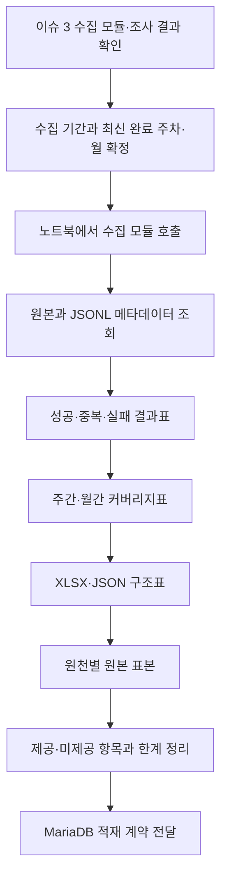

# 이슈 #4 RACOI 연간 자료 수집 노트북 개발계획

## 1. 단계 목표

이 단계에서는 이슈 #3의 수집 모듈과 원본·메타데이터를 이용해 최근 1년 RACOI 자료의 수집 범위, 실제 응답 구조, 성공·중복·실패 상태와 원본 표본을 하나의 한국어 Jupyter Notebook에서 확인할 수 있게 한다.

최종 결과는 다음 세 가지다.

1. `노트북/01_RACOI_자료_수집.ipynb`
2. 원천별 수집 결과·기간 커버리지·응답 구조·원본 표본을 보여주는 표
3. 이슈 #5의 MariaDB 원본 테이블 설계에 전달할 레코드 단위와 식별 필드 정리

이번 단계에서는 MariaDB 테이블 생성, 원본 정제, 결측값 대체, 분석 지표, 후보 순위와 Q1~Q6 그래프를 만들지 않는다.

## 2. 전체 개발 흐름



## 3. 작업 브랜치와 대상 파일

작업 브랜치:

```text
feature/issue-4-collection-notebook
```

구현 대상:

```text
노트북/
└── 01_RACOI_자료_수집.ipynb

데이터/
└── README.md
```

계획 문서:

```text
docs/계획 4th/
└── 이슈4_RACOI_연간_자료_수집_노트북_개발계획.md
```

원본과 실행 이력 입력:

```text
데이터/원본/
├── 수집_메타데이터.jsonl
├── 인터넷반응_주간/
├── 종합반응_월간/
└── 댓글반응_상세/
```

실제 원본 파일과 수집 메타데이터는 Git 추적 대상에 추가하지 않는다.

## 4. 선행 조건과 입력 계약

이슈 #4는 이슈 #3 완료 결과에 의존한다. 구현을 시작하기 전에 다음 항목을 확인한다.

| 선행 조건 | 확인 방법 | 미충족 시 처리 |
|---|---|---|
| 이슈 #3 수집 코드가 작업 브랜치에 포함됨 | `수집/RACOI_자료_내려받기.py`, `수집/수집_실행.py` 확인 | 이슈 #3 변경을 먼저 반영하고 노트북 구현을 보류 |
| 세 원천의 시범 수집 결과가 존재함 | 원본 폴더와 `수집_메타데이터.jsonl` 확인 | 수집 모듈의 `--probe` 실행 후 실제 결과 사용 |
| 실제 응답 구조가 문서화됨 | `docs/계획 3rd/RACOI_응답_구조_조사_결과.md` 확인 | 가상 구조를 만들지 않고 조사 결과부터 보완 |
| 기간 환경변수를 사용할 수 있음 | `.env.example`의 `DATA_START_DATE`, `DATA_END_DATE` 확인 | 환경변수 또는 실행 인자로 명시 |
| 원본·비밀정보가 Git에서 제외됨 | `.gitignore`, `git status --ignored` 확인 | 제외 규칙 보완 후 진행 |

2026년 11월 28일 이슈 #3 조사에서 확인된 입력 계약은 다음과 같다.

- 인터넷반응DB: 주간 코드 `YYYYWW`를 사용하는 XLSX
- 종합반응DB: 월 코드 `YYYYMM`를 사용하는 XLSX
- 댓글반응 상세: `pjseq`, `nweek`를 사용하는 공개 JSON 8종
- 수집 이력: 성공·중복·실패, URL, 기간, 체크섬, 파일 경로, 행 수와 구조 요약을 담은 JSONL
- 댓글반응 최신 주차: 인터넷반응 최신 주차와 별도로 확인

노트북은 이 계약을 표시하되 실제 로컬 원본과 메타데이터를 다시 읽어 일치 여부를 확인한다.

## 5. 노트북 표지와 핵심 질문

첫 번째 셀은 `문서/노트북_디자인_가이드.md`와 `프로젝트_소개/00_프로젝트_소개와_분석_페르소나.ipynb`를 따르는 대제목 표지로 작성한다.

제목:

```text
RACOI 연간 자료 수집
```

두 번째 셀은 다음 핵심 질문을 담은 전용 카드로 작성한다.

> 최근 1년 동안 어떤 RACOI 공개 자료를 어느 기간까지 확보했으며, 실제 응답 구조와 누락·제약은 무엇인가?

표지는 인디고·바이올렛·로즈 그라데이션을 사용하고, 핵심 질문은 연한 바이올렛 배경과 왼쪽 강조선으로 구분한다. 이 노트북은 Q1~Q6 질문 노트북이 아니므로 그래프 2개 규칙을 적용하지 않으며, 수집 결과는 그래프 대신 검증 가능한 표를 중심으로 보여준다.

## 6. 최근 1년 수집 기간 확정

노트북 상단에서 다음 기준을 먼저 설명하고 값으로 표시한다.

| 항목 | 의미 |
|---|---|
| 실행 기준일 | 노트북을 실행한 날짜와 KST 기준 |
| 시작일·종료일 | `.env` 또는 명시적 실행 인자로 받은 수집 범위 |
| 최신 완료 주차 | RACOI가 실제 제공하는 최신 주간 코드와 날짜 범위 |
| 최신 완료 월 | RACOI가 실제 제공하는 최신 월간 코드 |
| 댓글반응 최신 주차 | 대상 프로그램의 댓글반응 API가 제공하는 최신 주차 |

기간은 달력상 현재 주·월이 아니라 RACOI가 제공하는 최신 완료 주차·월을 기준으로 한다. 시작일·종료일이 없으면 수집 실행기의 기본 범위를 사용하되, 노트북 결과에 적용된 실제 값을 명시한다.

최근 1년은 시작일 이상·종료일 이하의 완료 주차와 완료 월로 구성한다. 주간과 월간 자료의 단위가 다르므로 하나의 행으로 합치거나 같은 건수로 비교하지 않는다.

## 7. 세 데이터 원천 설명

수집 실행 전에 세 원천의 차이를 설명하는 표를 둔다.

| 원천 | 기간 단위 | 실제 형식 | 주요 내용 | 후속 사용 |
|---|---|---|---|---|
| 인터넷반응DB | 주간 | XLSX | 프로그램별 미디어·시청자 반응과 시청 관련 원본 | 주간 분석용 원본 적재 |
| 종합반응DB | 월간 | XLSX | 프로그램별 월간 종합반응 원본 | 월간 분석용 원본 적재 |
| 댓글반응 상세 | 프로그램·주차·자료유형 | JSON | 키워드·감성·워드클라우드·연관어 공개 집계 | Q4·Q6 가능 범위 확인 |

댓글 원문 전체를 수집하는 노트북으로 표현하지 않는다. RACOI가 공개하는 집계 JSON만 사용하며, 공개되지 않는 중립 감성 건수나 전체 댓글 표본 수는 생성하거나 추정하지 않는다.

## 8. 수집 모듈 호출

노트북은 이슈 #3의 코드를 복사하지 않고 `수집/수집_실행.py`의 공개 실행 흐름을 호출한다.

실행 셀의 책임은 다음과 같다.

1. 프로젝트 루트와 환경변수 확인
2. 시작일·종료일·댓글 대상 `pjseq` 설정
3. 수집 실행기 호출
4. 실행 결과 객체와 최신 주차·월 정보 수신
5. 실패가 있어도 표를 표시할 수 있도록 상태 보존

기본 실행과 시범 실행을 구분한다.

| 모드 | 용도 | 범위 |
|---|---|---|
| 시범 실행 | 노트북 구조와 연결 확인 | 최신 1주·1개월·댓글 JSON 8종 |
| 연간 실행 | 이슈 #4 완료 결과 생성 | 설정된 최근 1년 주간·월간 및 필요한 댓글반응 범위 |

노트북의 실행 모드는 눈에 보이는 매개변수 셀에서 선택하고 결과 표에 기록한다. 이미 같은 체크섬의 파일이 있으면 `duplicate`를 정상적인 재실행 결과로 표시하되, 이를 새 수집 성공 건수에 합치지 않는다.

## 9. 수집 실행 요약표

수집 직후 다음 열을 가진 실행 요약표를 표시한다.

| 열 | 의미 |
|---|---|
| `source_name` | 주간·월간·댓글반응 구분 |
| `dataset_name` | 세부 자료유형 |
| `period_start`·`period_end` | 요청 대상 기간 |
| `pjseq`·`nweek` | 댓글반응 식별자 |
| `collection_status` | `success`, `duplicate`, `failed` |
| `http_status` | HTTP 상태 |
| `response_format` | XLSX·JSON 등 실제 판별 형식 |
| `row_count` | 확인 가능한 원본 행 또는 JSON 레코드 수 |
| `error` | 실패 사유 |

상태별 건수와 전체 시도 수를 함께 표시한다. `failed`와 미수집은 0건 또는 빈 값으로 바꾸지 않고 원인과 함께 남긴다.

## 10. 원천별 파일 목록표

`수집_메타데이터.jsonl`을 읽어 다음 파일 목록을 표시한다.

| 열 | 표시 원칙 |
|---|---|
| 원천·자료유형 | 사람이 읽을 수 있는 한국어 라벨 병기 |
| 기간·프로그램 | 주차, 월, `pjseq`를 분리 표시 |
| 저장 경로 | 프로젝트 상대경로만 표시 |
| 수집 시각 | KST와 시간대 표시 |
| 체크섬 | 전체 SHA-256 또는 앞부분과 전체값 조회 방법 제공 |
| 응답 크기 | 바이트 단위 명시 |
| 상태 | 성공·중복·실패 텍스트 라벨 사용 |

중복 이력은 원본 파일 수와 분리한다. 메타데이터가 가리키는 파일이 실제로 없으면 `누락 파일`로 표시하고 성공으로 간주하지 않는다.

## 11. 주간·월간 기간 커버리지표

커버리지는 기대 기간 목록과 실제 성공 또는 중복 메타데이터를 대조하여 작성한다.

주간 표:

| 주차 코드 | 기간 시작 | 기간 종료 | 인터넷반응 파일 | 댓글반응 범위 | 상태 | 누락 사유 |
|---|---|---|---|---|---|---|

월간 표:

| 월 코드 | 기간 시작 | 기간 종료 | 종합반응 파일 | 상태 | 누락 사유 |
|---|---|---|---|---|---|

표 아래에는 기대 주차·월 수, 확보 수, 누락 수와 적용 기간을 함께 적는다. 달력상 기간과 RACOI 코드의 경계가 다르면 RACOI 제공 코드를 우선하고 차이를 설명한다. 미관측 기간은 반응량 0이 아니라 `미수집` 또는 `미제공`으로 표시한다.

## 12. 원천별 응답 형식·구조 요약표

메타데이터의 `response_format`, `structure_summary`와 실제 파일을 대조하여 다음을 표시한다.

| 원천 | 형식 | 시트·최상위 구조 | 헤더·레코드 배열 | 행·레코드 수 | 기간·프로그램 식별자 | 비고 |
|---|---|---|---|---:|---|---|

확장자만으로 형식을 판단하지 않는다. XLSX는 ZIP 시그니처와 워크북 구조, JSON은 실제 파싱 성공 여부를 기준으로 한다. HTML 오류 페이지나 빈 응답은 정상 원본 구조로 표시하지 않는다.

## 13. Excel 시트·컬럼 구조표

인터넷반응과 종합반응 XLSX는 원본을 수정하지 않고 읽기 전용으로 열어 다음을 확인한다.

- 시트명과 시트 수
- 제목·설명 행과 실제 헤더 위치
- 다단 헤더 구조
- 원본 컬럼명과 열 수
- 물리 행 수와 실제 데이터 행 수
- 날짜·숫자·비율·단위 표현
- 빈 행, 병합 셀과 각주

인터넷반응의 2단 헤더와 종합반응의 3단 헤더를 임의로 평탄화하여 새 원본처럼 저장하지 않는다. 표시용 컬럼 라벨이 필요하면 원본 좌표와 원본 헤더를 함께 보여준다.

## 14. JSON 레코드·키 구조표

댓글반응 JSON 8종은 자료유형별로 다음을 표시한다.

| 자료유형 | 최상위 구조 | 레코드 배열 | 주요 키 | NULL·빈 배열 | 레코드 수 | 요청 식별자 |
|---|---|---|---|---|---:|---|

확인 대상은 댓글 키워드, 긍정댓글 키워드, 감성 추이, 감성 분포, 워드클라우드와 연관어 3종이다. 응답에 없는 `pjseq`, `nweek`, 요청 URL과 수집 시각은 응답 원문 필드가 아니라 수집 메타데이터에서 보충한 값임을 구분한다.

페이지네이션 키가 없거나 적용되지 않는 자료유형에는 `미제공`으로 표시한다. 빈 배열은 정상적인 0건 응답인지 오류인지 HTTP 상태와 자료유형별 구조를 함께 확인한다.

## 15. 댓글반응 제공·미제공 항목표

Q4와 Q6의 후속 구현 가능 범위를 다음 표로 정리한다.

| 항목 | 제공 여부 | 원천 자료유형 | 기간 단위 | 후속 사용 | 제한 |
|---|---|---|---|---|---|
| 키워드 | 실제 확인값 | 댓글 키워드·워드클라우드 | 프로그램·주차 | Q4 관심 주제 입력 검토 | 원천별 의미와 중복 확인 필요 |
| 긍정 키워드 | 실제 확인값 | 긍정댓글 키워드 | 프로그램·주차 | 긍정 맥락 보조 | 전체 감성 대표로 해석 금지 |
| 연관어·연결 강도 | 실제 확인값 | 연관어 JSON | 프로그램·주차 | Q4 관계 보조 | 의미 유사도 자체가 아님 |
| 긍정·부정 비율 | 실제 확인값 | 감성 분포·추이 | 프로그램·주차 | Q6 위험 검토 | 제공값 정의 확인 필요 |
| 중립 감성 | 미제공 | 없음 | 없음 | 직접 산출 불가 | 임의 생성 금지 |
| 전체 댓글 표본 수 | 미제공 여부 확인 | 없음 또는 보조 자료 | 프로그램·주차 | 충분성 판단 | 워드클라우드 건수를 댓글 수로 표현 금지 |

표의 제공 여부는 실제 파일을 읽은 결과로 채운다. 이슈 #3 조사 결과와 다르면 최신 실행 결과를 우선하되 차이와 실행 시각을 기록한다.

## 16. 원본 데이터 표본 표시

다음 표본을 각각 별도 셀에서 표시한다.

1. 인터넷반응 원본 표본
2. 종합반응 원본 표본
3. 댓글 키워드 또는 워드클라우드 표본
4. 댓글 감성 분포·추이 표본
5. 연관어 표본

표본은 원본 값과 필드명을 변경하지 않고 보통 5~10행만 표시하며 전체 행 또는 레코드 수를 함께 적는다. 개인정보나 댓글 원문이 포함되면 표시하지 않는다. 표본이 없으면 빈 가상 행을 만들지 않고 `원본 없음`, `미수집`, `미제공`, `파싱 실패`를 구분한다.

Python은 파일 읽기, 구조 확인, 수집 실행과 표시에만 사용한다. `groupby`, 통계 계산, 분석용 파생 지표, 후보 선별과 순위를 수행하지 않는다.

## 17. 노트북 셀 구성

권장 셀 순서는 다음과 같다.

| 순서 | 셀 유형 | 내용 |
|---:|---|---|
| 1 | Markdown | 대제목 표지 |
| 2 | Markdown | 핵심 질문 카드 |
| 3 | Markdown | 단계 목표와 제외 범위 |
| 4 | Code | 경로·환경·라이브러리 준비 |
| 5 | Markdown | 최근 1년과 완료 주차·월 기준 설명 |
| 6 | Code | 실행 매개변수와 기간 표시 |
| 7 | Markdown | 세 원천 차이 설명 |
| 8 | Code | 수집 모듈 호출 |
| 9 | Code | 수집 실행 요약표 |
| 10 | Code | 원천별 파일 목록표 |
| 11 | Code | 주간·월간 커버리지표 |
| 12 | Code | 응답 형식·구조 요약표 |
| 13 | Code | Excel 시트·컬럼 구조표 |
| 14 | Code | JSON 레코드·키 구조표 |
| 15 | Code | 댓글반응 제공·미제공 항목표 |
| 16~20 | Code | 원천별 실제 표본 |
| 21 | Markdown | 누락·제약·MariaDB 전달 기준 |
| 22 | Markdown | 핵심 질문에 대한 결론 |

실제 데이터 구조에 따라 셀을 나눌 수 있으나 표지, 핵심 질문, 표 10종, 원본 표본과 결론은 생략하지 않는다. 각 코드 셀 앞에는 목적·입력·출력과 실패 시 표시 방식을 한국어 Markdown으로 설명한다.

## 18. 표시할 표와 검증 기준

| 필수 표 | 최소 검증 기준 |
|---|---|
| 수집 실행 요약표 | 전체 시도 수와 상태별 건수 일치 |
| 원천별 파일 목록표 | 메타데이터 경로와 실제 파일 존재 여부 일치 |
| 주간 기간 커버리지표 | 기대 주차·확보·누락 수 합계 일치 |
| 월간 기간 커버리지표 | 기대 월·확보·누락 수 합계 일치 |
| 응답 형식·구조 요약표 | 실제 파싱 결과와 메타데이터 일치 |
| Excel 시트·컬럼 구조표 | 시트·헤더·열·행 정보 확인 가능 |
| JSON 레코드·키 구조표 | 자료유형별 키·NULL·레코드 수 확인 가능 |
| 댓글반응 제공·미제공 항목표 | 제공되지 않는 필드를 명시 |
| 인터넷·종합반응 원본 표본 | 원본 필드와 전체 행 수 표시 |
| 댓글반응 상세 표본 | 자료유형·`pjseq`·주차·레코드 수 표시 |

표에는 단위, 기간, 표본 수 또는 전체 행 수를 표시한다. 상태와 제약은 색상만으로 구분하지 않고 텍스트 라벨을 함께 사용한다.

## 19. 데이터 README 갱신

`데이터/README.md`에는 노트북 실행 결과와 모순되지 않도록 다음을 기록한다.

- 원본 폴더별 RACOI 출처
- 주간·월간·프로그램-주차 자료의 차이
- 원본 파일과 `수집_메타데이터.jsonl`의 관계
- 실제 원본과 댓글 원문의 Git 제외 정책
- 파일명·체크섬·수집 상태의 의미
- MariaDB 적재 전 원본을 수정하지 않는 보관 원칙

확보 기간과 행 수처럼 실행마다 바뀌는 값은 README에 고정 수치로 복제하지 않고 노트북 결과표를 기준으로 안내한다.

## 20. MariaDB 적재 전달 기준

노트북 결론에 이슈 #5가 사용할 레코드 단위와 식별 필드를 정리한다.

| 원본 | 적재 단위 | 필수 출처 식별자 |
|---|---|---|
| 인터넷반응 XLSX | 실제 데이터 행 1개 | 파일 체크섬, 시트, 원천 행 번호, 주차 |
| 종합반응 XLSX | 실제 데이터 행 1개 | 파일 체크섬, 시트, 원천 행 번호, 월 |
| 댓글반응 JSON | 자료유형별 반복 레코드 1개 | 파일 체크섬, `dataset_name`, `pjseq`, `nweek`, 배열 위치 |
| 수집 메타데이터 | 다운로드 시도 1회 | URL, 수집 시각, 기간, 상태, 체크섬, 파일 경로 |

다단 Excel 헤더의 원본 컬럼과 표시용 라벨 매핑, JSON 요청 메타데이터 보충 필드, 미제공 필드와 NULL·빈 배열의 의미를 함께 전달한다. 실제 구조에 없는 컬럼을 이슈 #5의 확정 스키마로 제안하지 않는다.

## 21. 구현 순서

1. 최신 `main`과 완료된 이슈 #3 변경을 기준으로 이슈 #4 브랜치 준비
2. 이슈 #3 계획서·응답 구조 조사 결과·수집 코드의 현재 인터페이스 확인
3. 실제 원본 폴더와 `수집_메타데이터.jsonl`의 존재·구조 확인
4. 표지·핵심 질문·단계 설명 Markdown 셀 작성
5. 프로젝트 경로, 환경변수와 실행 매개변수 셀 작성
6. 수집 실행기를 호출하고 결과 객체를 보존하는 셀 작성
7. 실행 요약과 원천별 파일 목록표 작성
8. 기대 주차·월과 실제 메타데이터를 대조하는 커버리지표 작성
9. XLSX 시트·헤더·컬럼 구조표 작성
10. 댓글반응 JSON 8종의 레코드·키 구조표 작성
11. 제공·미제공 항목표와 원천별 실제 표본 작성
12. 누락·실패·제약과 MariaDB 전달 기준 결론 작성
13. `데이터/README.md`의 출처·보관 규칙 갱신
14. 실제 원본·메타데이터·비밀정보가 Git 변경에 포함되지 않았는지 확인
15. 구현 주체는 완료 체크박스를 채우지 않고 검증 주체에게 실행 검증 요청

## 22. 완료 확인 시나리오

이슈 #4는 검증 주체가 다음 조건을 실제 실행 결과로 확인하면 완료한다.

- [ ] `노트북/01_RACOI_자료_수집.ipynb`이 생성됨
- [ ] 첫 셀이 대제목 표지이고 둘째 셀이 핵심 질문 카드임
- [ ] 최근 1년의 시작일·종료일과 최신 완료 주차·월 기준이 표시됨
- [ ] 인터넷반응·종합반응·댓글반응의 기간 단위와 사용 목적이 구분됨
- [ ] 수집 모듈 호출 결과가 성공·중복·실패 상태로 표시됨
- [ ] 원천별 파일명·URL·기간·체크섬과 실제 파일 존재 여부가 표시됨
- [ ] 주간·월간 기대 기간과 확보·누락 기간을 표로 대조할 수 있음
- [ ] 실제 XLSX의 시트·헤더·컬럼·행 구조가 표시됨
- [ ] 실제 JSON의 최상위 구조·레코드·키·NULL·식별자가 표시됨
- [ ] 댓글반응의 제공·미제공 필드가 구분됨
- [ ] 세 원천의 실제 원본 표본과 전체 행·레코드 수가 표시됨
- [ ] 누락·실패가 0으로 변환되거나 숨겨지지 않음
- [ ] Python이 수집·구조 확인·표시 외 분석 계산을 수행하지 않음
- [ ] `데이터/README.md`에 출처와 보관 규칙이 기록됨
- [ ] 이슈 #5의 MariaDB 적재 단위와 식별 필드가 정리됨
- [ ] 실제 원본, 메타데이터, 쿠키, 비밀번호와 개인정보가 Git에 포함되지 않음

## 23. 제외 범위

- MariaDB 연결, 데이터베이스와 테이블 생성
- XLSX·JSON 원본 수정과 변환 사본 저장
- 결측값 대체, 중복 행 제거와 프로그램명 통합
- SQL 품질검사와 분석용 테이블 생성
- Q1~Q6 지표·후보 순위·그래프
- 댓글 원문 수집과 자체 감성분석
- 제공되지 않는 중립 감성·전체 표본 수 추정

후속 단계는 다음 순서로 이어진다.

1. 이슈 #5에서 노트북이 확인한 실제 레코드 단위와 식별 필드를 기준으로 MariaDB 원본·분석용 테이블을 생성한다.
2. 데이터 적재 후 `문서/데이터_사전.md`를 실제 스키마와 결과에 맞게 갱신한다.
3. 품질검사와 전처리가 통과한 데이터만 Q1~Q6 질문 노트북에 전달한다.
