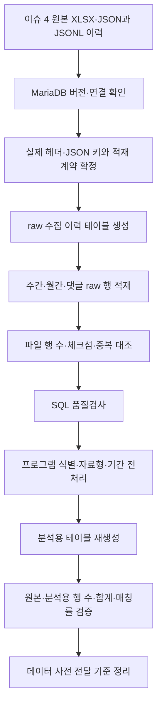

# 이슈 #5 MariaDB 데이터 적재·품질검사·전처리 개발계획

## 1. 단계 목표

이 단계에서는 이슈 #4에서 확보한 최근 1년 RACOI 원본 XLSX와 시범 댓글반응 JSON을 수정하지 않고 보존하면서, 원본 레코드를 MariaDB raw 테이블에 행 단위로 적재한다. 이후 품질검사와 전처리를 MariaDB SQL로 수행하여 Q1~Q6 질문 노트북이 사용할 수 있는 분석용 테이블을 만든다.

최종 결과는 다음 네 가지다.

1. `노트북/02_데이터_적재_품질_및_전처리.ipynb`
2. 수집 실행·주간·월간·댓글반응 원본을 추적하는 MariaDB raw 테이블
3. 프로그램·주간·월간·키워드·감성 단위의 재생성 가능한 분석용 테이블
4. 원본 파일과 MariaDB 적재 결과를 대조한 품질·커버리지·제외 사유 표

이번 단계에서는 Q1~Q6 지표 계산, 후보 선별, 순위, 그래프와 광고 추천을 만들지 않는다.

## 2. 전체 개발 흐름



## 3. 작업 브랜치와 대상 파일

작업 브랜치:

```text
feature/issue-5-mariadb-loading-quality
```

구현 대상:

```text
노트북/
└── 02_데이터_적재_품질_및_전처리.ipynb

문서/
└── 데이터_사전.md  # 실제 적재 결과가 확정된 뒤 후속 단계에서 갱신
```

상세 계획:

```text
docs/계획 5th/
└── 이슈5_MariaDB_데이터_적재_품질검사_전처리_개발계획.md
```

별도 `SQL/` 폴더나 변환 CSV를 만들지 않는다. DDL·적재 검증·전처리 SQL은 모두 노트북에 둔다.

## 4. 선행 조건과 입력 범위

| 선행 조건 | 현재 기준 | 미충족 시 처리 |
|---|---|---|
| MariaDB 접속 환경변수 | `.env.example`의 5개 `MARIADB_*` 값 | 비밀값을 노트북에 넣지 않고 실행 보류 |
| 최근 1년 인터넷반응 | `202547`~`202647`, 주간 53개 기간 | 누락 주차를 0으로 만들지 않고 실패 처리 |
| 최근 1년 종합반응 | `202511`~`202610`, 월간 12개 기간 | 누락 월을 0으로 만들지 않고 실패 처리 |
| 댓글반응 시범 원본 | `pjseq=11487`, 주차 `202645`·`202646` 중심 | 시범 범위만 적재하며 전체 후보 데이터로 표현 금지 |
| 수집 메타데이터 | `데이터/원본/수집_메타데이터.jsonl` | 파일과 이력이 불일치하면 raw 적재 전 반송 |
| 이슈 #4 노트북 | 기간·구조·파일 존재 표 실행 완료 | 오류 셀 또는 누락 파일을 먼저 해결 |

적재 범위는 로컬에 실제 존재하고 체크섬이 검증된 파일만 포함한다. 메타데이터에는 있으나 파일이 없는 행, `failed` 상태와 형식 검증 실패 파일은 수집 이력에는 기록하되 원본 데이터 행으로 적재하지 않는다.

## 5. 실제 원본 계약

### 5.1 인터넷반응 주간 XLSX

| 항목 | 확인 구조 |
|---|---|
| 한 파일의 기간 | 완료 주차 1개, `YYYYWW` |
| 시트 | `인터넷반응DB` 1개 |
| 헤더 | Excel 6~7행의 2단 헤더 |
| 데이터 | Excel 8행부터, 프로그램·주차 1행 |
| 열 | A~R, 18개 |
| 주요 값 | 게시글·댓글·동영상조회·뉴스·동영상, 점유율, 가구·2049 시청자 수와 시청률 |

XLSX `dimension=A1`은 실제 데이터 범위를 나타내지 않으므로 행 노드·헤더 위치와 수집 메타데이터의 구조 요약을 기준으로 읽는다.

### 5.2 종합반응 월간 XLSX

| 항목 | 확인 구조 |
|---|---|
| 한 파일의 기간 | 완료 월 1개, `YYYYMM` |
| 시트 | `종합반응DB` 1개 |
| 헤더 | Excel 6~8행의 3단 헤더 |
| 데이터 | Excel 9행부터, 프로그램·월 1행 |
| 열 | A~AF, 32개 |
| 주요 값 | 인터넷반응 5종, TV 시청자 수·시청률, TV VOD·PC·모바일 지표 |

`K` 단위 동영상조회와 VOD·PC·모바일의 반복 0은 원천 정의가 확인되기 전까지 임의로 환산하거나 실제 0으로 확정하지 않는다.

### 5.3 댓글반응 JSON

| 자료 단위 | 자료유형 | 주요 필드 |
|---|---|---|
| 키워드 | `comments_rank`, `positive_comments_rank`, `wordcloud` | `nweek`, `keyword`, `frequency`, `rk1`, `programid`, `sentimenttypecode` |
| 감성 | `sentiment_trend`, `sentiment_distribution` | `nweek`, `positivescore`, `negativescore` |
| 연관어 | `network_rank`, `network_edges`, `network_nodes` | `rk1`, `bigram`, `target`, `frequency` |

감성 점수는 긍정·부정 비율이며 건수가 아니다. 감성 API에는 중립 비율과 전체 감성 표본 수가 없다. 워드클라우드 레코드 수를 댓글 수로 사용하지 않는다.

## 6. MariaDB 연결과 버전 확인

첫 실행 셀에서 환경변수를 읽고 다음을 확인한다.

```sql
SELECT VERSION() AS mariadb_version;
SELECT DATABASE() AS database_name;
SELECT @@character_set_database AS character_set_database;
SELECT @@collation_database AS collation_database;
```

비밀번호·접속 문자열은 출력하지 않는다. MariaDB 버전을 확인한 뒤 JSON 자료형, `CHECK` 제약, 윈도 함수와 CTE의 지원 범위를 확정한다. 버전 호환성이 불분명하면 원문 JSON은 `LONGTEXT`로 저장하고 `JSON_VALID`을 품질검사에 사용한다.

## 7. 데이터 계층과 불변성

데이터 계층은 다음 두 단계만 사용한다.

```text
원본 파일 → raw 테이블 → analysis 테이블
```

- 원본 XLSX·JSON은 파일 시스템에 그대로 보존한다.
- raw 테이블은 최초 적재 후 `UPDATE`·`DELETE`하지 않는다.
- 정정이 필요하면 새 수집 실행과 새 체크섬으로 적재한다.
- 분석용 테이블은 노트북 SQL로 삭제 후 재생성할 수 있다.
- CSV·정리 Excel·임시 중간 테이블을 영구 계층으로 추가하지 않는다.

## 8. raw 수집 이력 테이블

`raw_ingestion_log`의 한 행은 다운로드 시도 1회다.

| 컬럼 | 역할 |
|---|---|
| `ingestion_run_id` | 적재 시 생성하는 수집 이력 PK |
| `source_name`, `dataset_name` | 원천·세부 자료유형 |
| `collection_status` | `success`, `duplicate`, `failed` |
| `source_url`, `collected_at` | 요청 출처와 KST 수집 시각 |
| `period_start`, `period_end` | 요청 기간 코드 |
| `request_pjseq`, `request_nweek` | 댓글반응 요청 식별자 |
| `http_status`, `content_type`, `response_format` | 응답 검증 정보 |
| `checksum`, `content_fingerprint` | 저장 파일 SHA-256과 내용 중복 지문 |
| `file_path`, `byte_count`, `row_count` | 원본 위치·크기·구조상 행 수 |
| `structure_summary_json`, `error_message` | 구조 요약과 실패 사유 |

동일 JSONL 행의 재적재 방지를 위해 원천·자료유형·수집시각·상태·체크섬을 결합한 `ingestion_event_key`를 생성하고 UNIQUE로 관리한다. 체크섬이 없는 실패 이력도 서로 다른 시도를 구분할 수 있어야 한다.

## 9. raw 인터넷반응 테이블

`raw_internet_response`의 한 행은 XLSX의 실제 데이터 행 1개다.

필수 출처 컬럼:

```text
raw_internet_response_id
ingestion_run_id
source_checksum
source_file_path
source_sheet_name
source_row_number
loaded_at
```

원본 값 컬럼:

```text
period_code
program_name
channel_name
broadcast_day_text
viewer_post_value
viewer_comment_value
viewer_video_view_value
media_news_value
media_video_value
viewer_post_share_value
viewer_comment_share_value
viewer_video_view_share_value
media_news_share_value
media_video_share_value
household_viewer_value
viewer_2049_value
household_rating_value
rating_2049_value
raw_payload_json
```

raw 값은 원본 표현을 손실 없이 보존할 수 있는 문자열 또는 충분한 정밀도의 자료형으로 적재한다. 숫자 변환과 단위 해석은 analysis 생성 SQL에서 수행한다. UNIQUE 키는 `source_checksum + source_sheet_name + source_row_number`로 둔다.

## 10. raw 종합반응 테이블

`raw_total_response`의 한 행은 월간 XLSX의 실제 데이터 행 1개다.

출처 컬럼은 주간 테이블과 동일하게 구성하고, 원본 값은 다음 범주를 포함한다.

- 월 코드, 프로그램명, 채널, 요일
- 게시글·댓글·동영상조회·뉴스·미디어 동영상
- TV 가구·개인·성별·10대~50대 시청자 수
- TV 가구·개인·성별·10대~50대 시청률
- TV VOD
- PC 실시간·VOD
- 모바일 실시간·VOD
- 전체 원본 행 `raw_payload_json`

3단 헤더는 상위·중간·하위 의미를 결합한 영문 snake_case 컬럼으로 매핑하되 원본 헤더 좌표와 매핑표를 노트북에 표시한다. UNIQUE 키는 `source_checksum + source_sheet_name + source_row_number`다.

## 11. raw 댓글반응 최소 분리

실제 JSON은 행 단위가 다르므로 하나의 넓은 `raw_comment_analysis`에 NULL 컬럼을 반복하지 않는다. 다음 세 테이블로 최소 분리한다.

| 테이블 | 한 행의 단위 | 고유 조합 |
|---|---|---|
| `raw_comment_keyword` | 프로그램·주차·자료유형·키워드 1개 | 체크섬+자료유형+배열 위치 |
| `raw_comment_sentiment` | 프로그램·요청 주차·반환 주차·자료유형 1개 | 체크섬+자료유형+배열 위치 |
| `raw_comment_network` | 프로그램·주차·자료유형·노드 또는 엣지 1개 | 체크섬+자료유형+배열 위치 |

공통 출처 컬럼:

```text
ingestion_run_id
source_checksum
source_file_path
dataset_name
source_array_index
request_pjseq
request_nweek
raw_payload_json
loaded_at
```

JSON 응답 원문에 없는 `pjseq`와 요청 주차는 수집 메타데이터에서 보충하며, 원문 필드와 보충 필드를 구분한다.

## 12. Python과 SQL 역할 분리

Python은 다음 작업만 수행한다.

- `.env` 로드와 MariaDB 연결
- XLSX 행·JSON 배열 읽기
- 원본 헤더와 필드의 손실 없는 행 매핑
- 매개변수화된 INSERT의 배치 실행
- SQL 결과를 DataFrame으로 조회·표시

SQL은 다음 작업을 수행한다.

- 자료형 변환과 날짜·기간 정규화
- 중복·NULL·음수·범위·기간 누락 검사
- 프로그램 식별·매칭
- 분석용 테이블 생성
- 행 수·합계·매칭률·제외 사유 집계

Python `groupby`, `merge`, 비율·순위·통계 계산으로 SQL 분석을 대체하지 않는다.

## 13. 전처리 설계 설명과 사용자 확인

전처리를 실제로 실행하기 전에 다음 내용을 사용자에게 한국어로 자세히 설명하고 `이 기준으로 전처리할까요?`라고 확인한다.

| 설명할 내용 | 반드시 포함할 판단 |
|---|---|
| 원본에서 발견된 문제 | 중복·빈 셀·숫자 변환 실패·기간 누락·프로그램명 충돌의 실제 건수와 표본 |
| 제안하는 처리 | 유지·제외·NULL 변환·별도 상태 플래그·프로그램 매핑 방식 |
| 선택 이유 | 해당 처리가 필요한 이유와 분석 질문에 미치는 영향 |
| 대안 | 원본 유지, 분석 제외, 수동 매핑 등 가능한 다른 방식 |
| 결과 변화 | 처리 전후 예상 행 수·프로그램 수·기간 수·합계 변화 |
| 복구 가능성 | raw는 수정하지 않고 analysis를 다시 생성할 수 있다는 점 |

다음처럼 설계 판단이 필요한 항목은 사용자 확인 없이 임의 확정하지 않는다.

- 프로그램명·채널 충돌을 같은 프로그램으로 통합하는 기준
- 원본 0을 실제 0 또는 미제공으로 해석하는 기준
- 숫자 변환 실패 행의 제외 여부
- 내용이 다른 동일 기간 파일 중 사용할 버전
- 최소 관측 기간·데이터 충분성 기준
- 원천 단위가 다른 주간·월간 값을 결합하거나 환산하는 방식
- 시청자 수·시청률·플랫폼 지표의 단위 보정

명백한 형식 처리도 무엇을 하는지 먼저 설명한다. 다만 공백 제거, 자료형 변환처럼 원본 의미를 바꾸지 않는 처리와 프로그램 통합·제외처럼 분석 모집단을 바꾸는 판단을 구분하여 표시한다. 사용자 확인 결과와 선택한 기준은 노트북 Markdown 셀과 실행 파라미터 표에 남겨 재실행할 수 있게 한다.

## 14. 적재 트랜잭션과 재실행 안전성

파일 1개를 하나의 적재 단위로 처리한다.

1. 메타데이터와 실제 파일 경로·체크섬 확인
2. raw 수집 이력 INSERT
3. 파일의 모든 데이터 행을 배치 INSERT
4. 파일 구조상 기대 행 수와 INSERT된 행 수 비교
5. 일치하면 COMMIT
6. 오류 또는 행 수 불일치 시 ROLLBACK하고 실패 원인 표시

raw 데이터는 `INSERT IGNORE` 또는 명시적 존재 확인 후 INSERT만 사용한다. `ON DUPLICATE KEY UPDATE`로 기존 raw 값을 바꾸지 않는다. 같은 파일을 두 번 실행한 뒤 raw 행 수가 증가하지 않는지 확인한다.

## 15. 주간·월간 기간 단위를 유지하는 이유

주간과 월간을 나누는 첫 번째 이유는 RACOI 원천이 실제로 다른 단위로 제공되기 때문이다.

| 원천 | 실제 제공 단위 | 주요 내용 |
|---|---|---|
| 인터넷반응DB | 프로그램·주차 | 게시글·댓글·동영상조회·뉴스·미디어 동영상, 가구·2049 시청 정보 |
| 종합반응DB | 프로그램·월 | 월간 인터넷반응, 성별·연령별 TV 시청 정보, VOD·PC·모바일 지표 |
| 댓글반응 상세 | 프로그램·주차·자료유형 | 키워드·감성·연관어 공개 집계 |

두 번째 이유는 질문별 분석 의도도 다르기 때문이다.

- Q1·Q3·Q4는 최근 몇 주의 시청·반응·댓글 맥락을 확인하므로 주간 변화와 최신성이 중요하다.
- Q2는 프로그램의 시청 규모 대비 월간 종합 온라인 관심을 비교하므로 월간 종합반응이 적합하다.
- Q5·Q6은 주차별 성장·지속성·감성 변화를 보므로 주간 연속성이 필요하다.

월간 값을 주간으로 단순 복제하면 같은 값을 4~5회 반복해 표본을 부풀리게 되고, 주간 값을 월간 행에 바로 JOIN하면 프로그램별 주차 수만큼 월간 행이 중복된다. 따라서 다음 원칙을 따른다.

1. raw와 기본 analysis 테이블에서는 원천의 주간·월간 grain을 그대로 유지한다.
2. 주간-월간 비교가 필요하면 각 원천을 먼저 해당 기간 단위로 집계한다.
3. 기간 시작일·종료일을 이용해 실제 겹치는 범위를 확인한 뒤 결합한다.
4. 월간 값을 임의로 주간 분할하거나 주간 값을 월간 값처럼 반복하지 않는다.
5. 공통 기간이 부족하면 결합 결과를 만들지 않고 데이터 부족으로 표시한다.

즉, 데이터가 원래 주간·월간으로 다르게 제공되는 것이 기본 이유이고, 분석 질문도 최신 주간 변화와 안정적인 월간 종합 규모를 서로 다르게 사용하도록 설계되어 있어 그 단위를 유지하는 것이 의도에도 맞다.

## 16. 프로그램 식별 전략

주간·월간 XLSX에는 댓글 API의 `pjseq`가 없으므로 프로그램 식별을 다음 순서로 처리한다.

1. 원본 프로그램명과 채널을 별도 컬럼으로 보존
2. SQL에서 공백·대소문자·기호를 제한적으로 정규화
3. `normalized_program_name + normalized_channel_name`을 보조 고유키로 사용
4. 동일 조합이 여러 프로그램으로 충돌하면 자동 병합하지 않고 매핑 실패로 기록
5. 확인된 `pjseq`만 nullable 컬럼으로 연결

프로그램명이 같더라도 채널·방영 시기가 다르면 같은 프로그램으로 강제 통합하지 않는다. 모호한 매칭은 Q1~Q6 입력에서 제외하고 사유를 표로 남긴다.

## 17. 품질검사 SQL

다음 검사를 SQL 결과표로 표시한다.

| 검사 | 확인 내용 |
|---|---|
| 원본 완결성 | 기대 53주·12개월과 실제 파일·적재 기간 수 비교 |
| 행 수 | XLSX 실제 데이터 행·JSON 배열 길이와 raw 행 수 비교 |
| 체크섬 | raw 행의 `source_checksum`과 수집 이력 연결 실패 건수 |
| 고유성 | 원천 파일·시트·행 번호 및 JSON 배열 위치 중복 |
| 기간 | 잘못된 `YYYYWW`·`YYYYMM`, 역전, 미완료 기간 |
| 프로그램 | 빈 이름·채널, 정규화 충돌, 주간-월간 매칭률 |
| 숫자 | 숫자 변환 실패, 음수 count, 비율·시청률 범위 |
| NULL·0 | 미수집, 빈 셀, 실제 문자열 0, 변환 실패 구분 |
| 댓글 | 요청 식별자 누락, 감성 합 1 검증, 키워드 빈 값 |
| JSON | `JSON_VALID`, 필수 키 누락, 빈 배열과 정상 0건 구분 |

각 검사 결과는 실패 건수뿐 아니라 대상 전체 건수, 비율, 대표 표본 5~20행과 판정 상태를 함께 표시한다.

## 18. NULL·0·미수집 기준

| 원본 상태 | raw 저장 | analysis 처리 |
|---|---|---|
| 파일 또는 기간 미수집 | raw 행 없음, 수집 이력에 누락·실패 | 0으로 생성하지 않음 |
| 원본 빈 셀 | NULL 또는 원본 빈 문자열 구분 보존 | 지표별 제외·UNKNOWN |
| 원본 숫자 `0` | 원본값 0 보존 | 정의 확인된 지표만 실제 0 사용 |
| 숫자 변환 실패 | 원본 문자열 보존 | NULL 변환 후 품질 실패 사유 기록 |
| API 빈 배열 | 성공 응답과 빈 배열 사실 보존 | 데이터 없음으로 표시, 실패와 구분 |

VOD·PC·모바일과 시청 관련 반복 0은 원천 정의가 확인될 때까지 미제공 가능성을 별도 플래그로 관리한다.

## 19. 전처리 과정별 작성 원칙

전처리는 하나의 긴 코드 셀에 몰아서 작성하지 않는다. 각 과정은 다음 네 단계가 반복되는 작은 단위로 구성한다.

```text
1. 처리 전 문제와 실제 표본 설명
2. 적용할 기준·이유·대안 설명
3. 한 가지 목적만 수행하는 SQL 실행
4. 처리 후 결과와 전후 비교표 표시
```

권장 전처리 단위:

1. 원본 행 수와 파일별 적재 행 수 확인
2. 완전 중복과 내용 충돌 중복 분리
3. 기간 코드 검증과 시작일·종료일 생성
4. 프로그램명·채널 기본 정규화
5. 프로그램 식별 충돌·미일치 분리
6. count 계열 숫자 변환과 실패 행 확인
7. 비율·시청률 자료형과 범위 확인
8. NULL·빈 문자열·원본 0 상태 구분
9. 주간 분석용 테이블 생성
10. 월간 분석용 테이블 생성
11. 댓글 키워드·감성·연관어 분석용 테이블 생성
12. 제외 사유와 최종 분석 가능 범위 확인

각 과정 앞 Markdown 셀에는 목적, 입력, 발견한 문제, 처리 기준, 왜 필요한지, 원본 보존 여부와 다음 단계에 미치는 영향을 적는다. SQL 셀은 설명한 한 가지 처리만 수행한다. SQL 실행 직후에는 다음 전후 결과를 표로 보여준다.

| 전후 결과 | 표시 내용 |
|---|---|
| 행 수 | 처리 전·후·제외·보류 행 수 |
| 프로그램 | 처리 전·후 고유 프로그램 수, 매핑 성공·충돌·미일치 수 |
| 기간 | 처리 전·후 최소·최대 기간과 주·월 수 |
| NULL·0 | 컬럼별 NULL·빈 값·0·변환 실패 건수 |
| 합계 | count 계열 원본 합계와 analysis 합계, 차이와 이유 |
| 표본 | 변경·제외·보류된 대표 행 5~20개 |

여러 전처리를 한 셀에서 연속 실행한 뒤 마지막 결과만 보여주는 구성은 사용하지 않는다. 결과가 바뀌지 않은 처리도 전후 동일함을 표로 확인한다.

## 20. 분석용 프로그램 테이블

`analysis_program`의 한 행은 구분 가능한 프로그램 1개다.

초안 컬럼:

```text
program_id
pjseq
program_name
normalized_program_name
channel_name
normalized_channel_name
first_observed_period
last_observed_period
has_weekly_data
has_monthly_data
has_comment_data
mapping_status
```

원본에 장르·방영 시작일·종료일이 없으면 빈 가상 컬럼을 채우지 않는다. 해당 값은 별도 공개 원천이 실제 확보된 뒤 확장한다.

## 21. 분석용 주간 테이블

`analysis_program_weekly`의 한 행은 프로그램·완료 주차 1개다.

초안 컬럼:

```text
program_id
week_code
week_start_date
week_end_date
post_count
comment_count
video_view_count
news_count
media_video_count
post_share
comment_share
video_view_share
news_share
media_video_share
household_viewer_count
viewer_2049_count
household_rating
rating_2049
source_checksum
quality_status
```

같은 프로그램·주차에 복수 유효 원본이 있으면 동일 내용 지문을 중복 제거하고, 내용이 다른 버전은 수집 시각과 품질 상태를 근거로 자동 선택하지 않고 충돌로 표시한다.

## 22. 분석용 월간 테이블

`analysis_program_monthly`의 한 행은 프로그램·완료 월 1개다.

초안 컬럼:

- 게시글·댓글·동영상조회·뉴스·미디어 동영상
- TV 가구·개인·성별·연령별 시청자 수
- TV 가구·개인·성별·연령별 시청률
- VOD·PC·모바일 원본 지표와 단위 확인 상태
- 출처 체크섬과 품질 상태

월간 값은 주간 값으로 변환하거나 주간 테이블과 행 단위로 직접 조인하지 않는다. Q2는 월간 단위에서 먼저 계산한다.

## 23. 분석용 키워드·감성·연관어 테이블

실제 제공 범위에 맞춰 다음 테이블을 생성한다.

| 테이블 | 한 행의 단위 | 주요 값 |
|---|---|---|
| `analysis_keyword_weekly` | 프로그램·주차·자료유형·키워드 | 언급량, 순위, 감성 유형 코드 |
| `analysis_sentiment_weekly` | 프로그램·주차·자료유형 | 긍정 비율, 부정 비율, 표본 상태 |
| `analysis_keyword_edge` | 프로그램·주차·자료유형·원천·대상 키워드 | 연결 빈도 |

중립 감성 비율, 긍정·부정 건수와 전체 댓글 수는 원천에 없으므로 만들지 않는다. 현재는 시범 프로그램 데이터만 존재하므로 전체 후보 분석 입력으로 사용하지 않고 스키마·품질 검증용임을 표시한다.

## 24. 생성하지 않을 테이블과 필드

현재 원천만으로 다음을 확정하지 않는다.

- `analysis_audience_weekly`의 20대 여성·30대 여성 교차 비중
- 댓글 긍정·중립·부정 건수
- 전체 댓글 표본 수
- 프로그램 장르·출연자·방영 시작일·종료일
- 광고 효과·ROI·비용 효율 지표

종합반응에 연령·성별 각각의 시청 지표가 있어도 20~30대 여성 교차 시청층으로 가정하지 않는다. 필요한 상세 시청층 원천이 확보되기 전까지 Q1의 해당 지표는 데이터 부족 상태로 남긴다.

## 25. 노트북 셀 구성

| 순서 | 셀 유형 | 내용 |
|---:|---|---|
| 1 | Markdown | 대제목 표지 |
| 2 | Markdown | 핵심 질문 카드 |
| 3 | Markdown | 범위·입력·제외 범위 |
| 4 | Code | 환경변수·프로젝트 경로 준비 |
| 5 | Code | MariaDB 연결과 버전·문자셋 확인 |
| 6 | Code | 원본 파일·메타데이터 사전검사 |
| 7 | Markdown/Code | 실제 헤더·JSON 키와 매핑표 |
| 8 | SQL | raw 수집 이력 DDL |
| 9 | SQL | raw 주간·월간 DDL |
| 10 | SQL | raw 댓글 3종 DDL |
| 11 | Code | Python 원본 행 읽기·배치 INSERT |
| 12 | SQL | raw 표본·행 수·중복 검사 |
| 13 | Markdown/SQL/표 | 중복 처리 설명 → 실행 → 전후 결과 |
| 14 | Markdown/SQL/표 | 기간 검증 설명 → 실행 → 전후 결과 |
| 15 | Markdown/SQL/표 | 프로그램 정규화·매핑 설명 → 실행 → 전후 결과 |
| 16 | Markdown/SQL/표 | 숫자·NULL·0 처리 설명 → 실행 → 전후 결과 |
| 17 | Markdown | 발견 문제·처리 대안·영향 설명과 사용자 확인 결과 |
| 18 | SQL/표 | analysis 프로그램 생성과 전후 비교 |
| 19 | SQL/표 | analysis 주간 생성과 전후 비교 |
| 20 | SQL/표 | analysis 월간 생성과 전후 비교 |
| 21 | SQL/표 | analysis 키워드·감성·연관어 생성과 전후 비교 |
| 22 | SQL | 원본·분석용 행 수·합계·매칭률 비교 |
| 23 | Markdown | 품질 문제·제외 사유·후속 한계 결론 |

중요한 값의 단위나 행의 의미가 달라질 때마다 5~20행 표와 전체 행 수를 바로 표시한다. 전처리 설명과 SQL, 전후 결과는 서로 떨어뜨리지 않고 하나의 작은 처리 단위로 연속 배치한다.

## 26. SQL 주석 규칙

모든 SQL 셀 상단에 다음 다섯 항목을 작성한다.

```sql
-- 목적: 이 SQL이 해결하는 문제
-- 입력: 사용하는 원본·raw·analysis 테이블
-- 출력 단위: 결과 한 행의 의미
-- 분석 기간: 적용 기간 코드와 기준일
-- NULL/0 처리: 미수집·빈 셀·실제 0·변환 실패 기준
```

주요 CTE, JOIN, 윈도 함수, 형변환, 후보가 아닌 품질 필터, 동률·중복 처리 앞에도 판단 이유를 한국어로 주석 처리한다.

## 27. 검증 표와 완료 근거

| 필수 표 | 최소 확인 내용 |
|---|---|
| MariaDB 환경표 | 버전, 데이터베이스명, 문자셋·collation |
| 원본 파일 목록표 | 원천, 기간, 체크섬, 파일 존재, 적재 대상 여부 |
| 헤더·JSON 매핑표 | 원본 좌표·필드와 raw 컬럼 연결 |
| 적재 실행표 | 파일별 기대 행·INSERT·중복·실패 건수 |
| raw 행 수표 | 테이블별 전체 행·기간·파일 수 |
| 품질 진단표 | 중복·NULL·음수·변환 실패·기간 누락 |
| 프로그램 매칭표 | 전체·일치·충돌·미일치 프로그램 수와 비율 |
| 전처리 비교표 | raw와 analysis 행 수·주요 합계 차이 |
| 분석용 표본 | 테이블별 5~20행, grain과 전체 행 수 |
| 제외 사유표 | 사유별 제외 행·프로그램·기간 수 |
| 전처리 의사결정표 | 발견 문제, 제안 처리, 대안, 사용자 확인 결과, 적용 파라미터 |
| 과정별 전후 비교표 | 각 전처리 직전·직후 행 수·프로그램·기간·NULL·0·합계 변화 |

문서에 적는 수치는 실제 SQL 결과와 대조할 수 있어야 한다.

## 28. 구현 순서

1. 최신 `main`과 이슈 #4 병합 결과 기준 이슈 #5 브랜치 준비
2. MariaDB 환경변수와 실제 버전·문자셋 확인
3. 원본 53주·12개월과 댓글 시범 파일의 체크섬·존재 사전검사
4. 실제 XLSX 헤더·JSON 키를 raw 컬럼 매핑표로 확정
5. `raw_ingestion_log` DDL과 적재 구현
6. `raw_internet_response`, `raw_total_response` DDL 구현
7. 댓글 키워드·감성·연관어 raw DDL 구현
8. Python의 손실 없는 파일 읽기와 배치 INSERT 구현
9. 동일 파일 재적재 중복 방지와 트랜잭션 롤백 검증
10. raw 표본·행 수·파일 원본 행 수 비교
11. 발견한 품질 문제와 전처리 대안·영향을 사용자에게 설명
12. `이 기준으로 전처리할까요?` 확인 후 선택 기준을 노트북에 기록
13. 중복·기간·프로그램·숫자·NULL·0 전처리를 과정별 Markdown→SQL→전후 표로 구현
14. 각 과정의 제외·보류 행과 원본·결과 합계 차이를 즉시 확인
15. `analysis_program`, 주간·월간 테이블 재생성 SQL 구현
16. 실제 제공 범위의 키워드·감성·연관어 분석용 테이블 구현
17. raw와 analysis 행 수·합계·기간·매칭률 비교
18. 데이터 부족·제외 사유와 이슈 #6 전달 기준 결론 작성
19. 원본·비밀정보가 Git 변경에 포함되지 않았는지 확인
20. 구현 주체는 완료 체크박스를 채우지 않고 검증 주체에게 실제 DB 실행 검증 요청

## 29. 완료 확인 시나리오

이슈 #5는 검증 주체가 다음 조건을 실제 MariaDB 실행 결과로 확인하면 완료한다.

- [ ] `노트북/02_데이터_적재_품질_및_전처리.ipynb`이 처음부터 끝까지 실행됨
- [ ] `SELECT VERSION()`과 데이터베이스 문자셋 결과가 표시됨
- [ ] 53주·12개월 원본 파일의 적재 대상 여부와 누락이 표로 확인됨
- [ ] 수집 이력과 주간·월간·댓글 raw 테이블이 생성됨
- [ ] 모든 raw 행이 수집 이력·파일·체크섬·원천 위치로 추적됨
- [ ] 파일 실제 데이터 행 수와 MariaDB raw 행 수가 일치하거나 차이 사유가 표시됨
- [ ] 같은 파일을 다시 적재해도 raw 행 수가 증가하지 않음
- [ ] raw 테이블에 `UPDATE`·`DELETE`가 수행되지 않음
- [ ] 중복·NULL·음수·변환 실패·기간 누락 결과가 표로 표시됨
- [ ] 미수집과 실제 0이 구분됨
- [ ] 분석용 프로그램·주간·월간 테이블이 SQL로 재생성됨
- [ ] 실제 제공 범위의 키워드·감성·연관어 테이블이 생성됨
- [ ] 분석용 테이블의 grain과 고유키가 결과로 확인됨
- [ ] raw와 analysis 행 수·합계·프로그램 매칭률이 비교됨
- [ ] 제공되지 않는 세부 시청층·중립 감성·댓글 건수를 생성하지 않음
- [ ] Python이 집계·비율·순위·분석 전처리를 수행하지 않음
- [ ] 전처리 전 발견 문제·처리 기준·대안·영향을 사용자에게 자세히 설명하고 확인받음
- [ ] 사용자 확인 결과와 실제 적용 파라미터가 노트북에 기록됨
- [ ] 전처리가 목적별 작은 단계로 나뉘고 각 단계에 Markdown 설명·SQL·전후 결과표가 있음
- [ ] 주간·월간 grain을 유지하는 원천 구조와 분석상 이유가 노트북에 설명됨
- [ ] 각 전처리 후 행 수·프로그램 수·기간·NULL·0·합계 변화가 확인됨
- [ ] 비밀번호·접속 문자열·원본 파일·원문 댓글이 Git에 포함되지 않음

## 30. 제외 범위

- 최근 1년 원본의 재수집과 댓글 후보군 추가 수집
- Q1~Q6 분석 지표·회귀·TF-IDF·추세·감성 위험 계산
- 후보 필터링, 순위와 종합 점수
- 그래프 생성
- 제공되지 않는 시청층·감성·프로그램 프로필 추정
- 원본 파일 수정 또는 CSV 중간 계층 생성
- 실제 광고 효과·ROI 평가

후속 단계는 다음 순서로 이어진다.

1. 이슈 #6에서 실제 스키마·자료형·키·NULL·0 기준을 `문서/데이터_사전.md`에 확정한다.
2. Q1~Q3에서 전체 주간·월간 분석용 테이블로 후보군을 축소한다.
3. Q3 이후 후보 `pjseq`가 확정되면 Q4·Q6에 필요한 댓글반응 기간을 추가 수집·적재한다.
4. 데이터 부족으로 구현할 수 없는 질문은 임의 값을 만들지 않고 보류 상태로 보고한다.
