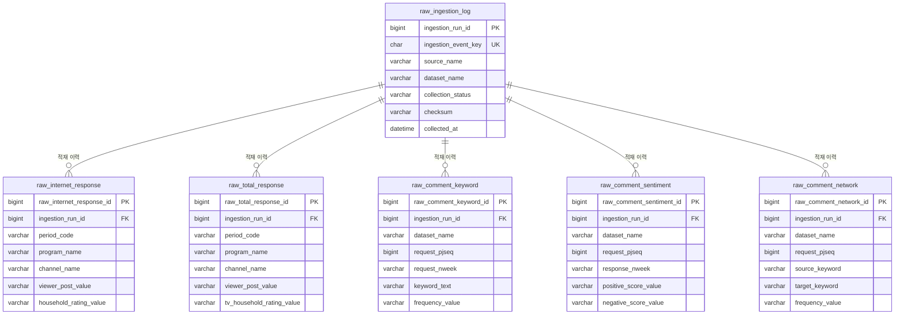

# 이슈 5 원본 적재 ERD

> 첫 번째 PR 범위: 원본 보존 적재와 적재 품질 확인. 전처리·분석 테이블은 아직 만들지 않는다.

## 테이블과 원본값의 대응

| MariaDB 테이블 | 적재 원본 | 원본값이 들어가는 방식 | 현재 건수 |
|---|---|---|---:|
| `raw_ingestion_log` | `데이터/원본/수집_메타데이터.jsonl` | 요청 URL·수집 시각·상태·기간·파일 경로·체크섬을 한 수집 사건당 한 행으로 보존 | 166 |
| `raw_internet_response` | 인터넷 반응 주간 XLSX | 7행까지는 원본 양식 헤더로 건너뛰고, 8행부터 18개 열을 텍스트 그대로 적재 | 8,484 |
| `raw_total_response` | 통합 반응 월간 XLSX | 8행까지는 원본 양식 헤더로 건너뛰고, 9행부터 32개 열을 텍스트 그대로 적재 | 2,797 |
| `raw_comment_keyword` | 댓글 키워드 JSON (`comments_rank`, `positive_comments_rank`, `wordcloud`) | 배열 원소 하나를 한 행으로 적재하고, 원본 객체 전체도 `raw_payload_json`에 보존 | 840 |
| `raw_comment_sentiment` | 댓글 감성 JSON (`sentiment_trend`, `sentiment_distribution`) | 요청 주차와 응답 주차, 긍정·부정 점수를 원문 문자열로 적재 | 15 |
| `raw_comment_network` | 댓글 네트워크 JSON (`network_rank`, `network_edges`, `network_nodes`) | 키워드 쌍·빈도 또는 순위 데이터를 배열 원소별로 적재 | 59 |

각 응답 테이블의 `ingestion_run_id`는 `raw_ingestion_log.ingestion_run_id`를 가리킨다. 따라서 분석 중에도 어느 파일·요청에서 온 행인지 역추적할 수 있다. 숫자처럼 보이는 값도 이 단계에서는 `VARCHAR`로 보존했으며, 원본 JSON/XLSX 한 행의 전체 모습은 `raw_payload_json`에 함께 남긴다.

## 적재 단위가 서로 다른 이유

원본 API가 주는 단위가 다르다. 인터넷 반응은 **주간**, 통합 반응은 **월간**, 댓글은 **프로그램·요청 주차·댓글 유형** 단위다. 이는 임의로 기간을 나눈 것이 아니라 원본 응답의 단위를 그대로 보존한 것이다. 이후 분석에서도 월간 값을 주간으로 복제하거나, 서로 다른 단위를 곧바로 조인하지 않는다.
