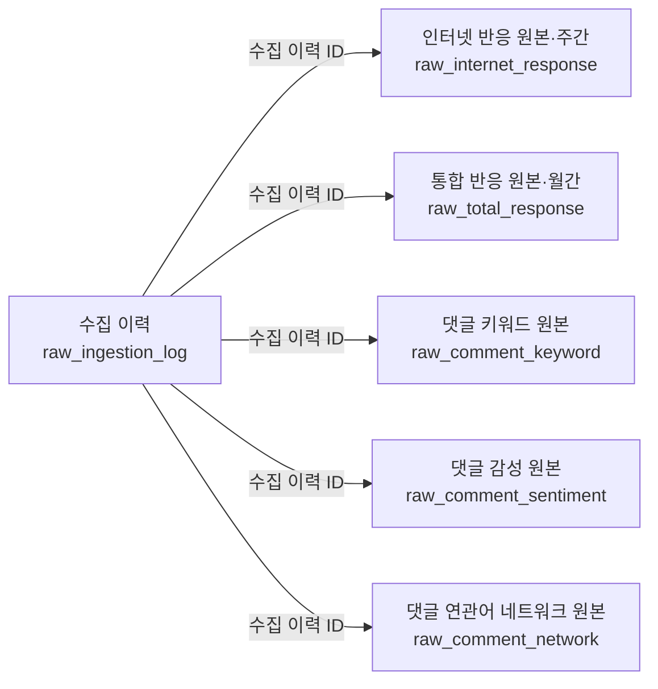

# 이슈 5 원본 적재 ERD

> 첫 번째 PR 범위: 원본 보존 적재와 적재 품질 확인. 전처리·분석 테이블은 아직 만들지 않는다.

## 테이블과 원본값의 대응

| MariaDB 테이블 | 적재 원본 | 원본값이 들어가는 방식 | 현재 건수 |
|---|---|---|---:|
| `raw_ingestion_log` | `데이터/원본/수집_메타데이터.jsonl` | 요청 URL·수집 시각·상태·기간·파일 경로·체크섬을 한 수집 사건당 한 행으로 보존 | 166 |
| `raw_internet_response` | 인터넷 반응 주간 XLSX | 7행까지는 원본 양식 헤더로 건너뛰고, 8행부터 18개 열을 텍스트 그대로 적재 | 8,484 |
| `raw_total_response` | 통합 반응 월간 XLSX | 8행까지는 원본 양식 헤더로 건너뛰고, 9행부터 32개 열을 텍스트 그대로 적재 | 2,797 |
| `raw_comment_keyword` | 댓글 키워드 JSON (`comments_rank`, `positive_comments_rank`, `wordcloud`) | 배열 원소 하나를 한 행으로 적재하고, 원본 객체 전체도 `raw_payload_json`에 보존 | 840 |
| `raw_comment_sentiment` | 댓글 감성 JSON (`sentiment_trend`, `sentiment_distribution`) | 요청 주차와 응답 주차, 긍정·부정 점수를 원문 문자열로 적재 | 15 |
| `raw_comment_network` | 댓글 네트워크 JSON (`network_rank`, `network_edges`, `network_nodes`) | 키워드 쌍·빈도 또는 순위 데이터를 배열 원소별로 적재 | 59 |

각 응답 테이블의 `ingestion_run_id`는 `raw_ingestion_log.ingestion_run_id`를 가리킨다. 따라서 분석 중에도 어느 파일·요청에서 온 행인지 역추적할 수 있다. 숫자처럼 보이는 값도 이 단계에서는 `VARCHAR`로 보존했으며, 원본 JSON/XLSX 한 행의 전체 모습은 `raw_payload_json`에 함께 남긴다.

## ERD 한글 명칭과 전체 컬럼

아래는 위 ERD의 영문 물리명과 함께 읽는 한글 명칭이다. PK는 기본키, FK는 수집 이력 기본키를 참조하는 외래키, UK는 원본 행 중복 방지 키다.

| 테이블 (한글명) | 전체 컬럼 (영문명 · 한글명) |
|---|---|
| `raw_ingestion_log` 수집 이력 | `ingestion_run_id` · 적재 실행 ID (PK) `ingestion_event_key` · 수집 사건 식별키 (UK) `source_name` · 수집원 이름 `dataset_name` · 데이터셋 이름 `collection_status` · 수집 상태 `source_url` · 원본 요청 주소 `collected_at` · 수집 시각 `period_start`, `period_end` · 요청 시작·종료 기간 `request_pjseq`, `request_nweek` · 댓글 요청 프로그램 ID·주차 `http_status`, `content_type`, `response_format` · 응답 상태·형식 `checksum`, `content_fingerprint` · 파일·내용 지문 `file_path`, `byte_count`, `row_count` · 저장 경로·크기·행 수 `structure_summary_json`, `error_message`, `loaded_at` · 구조 요약·오류·DB 적재 시각 |
| `raw_internet_response` 인터넷 반응 원본 (주간) | `raw_internet_response_id` · 원본 행 ID (PK) `ingestion_run_id` · 수집 이력 ID (FK) `source_checksum`, `source_file_path`, `source_sheet_name`, `source_row_number` · 원본 파일 지문·경로·시트·행 번호 `period_code`, `program_name`, `channel_name`, `broadcast_day_text` · 주차·프로그램명·채널·방송 요일 `viewer_post_value`, `viewer_comment_value`, `viewer_video_view_value` · 시청자 게시글·댓글·영상 조회 `media_news_value`, `media_video_value` · 미디어 뉴스·영상 `viewer_post_share_value`, `viewer_comment_share_value`, `viewer_video_view_share_value` · 시청자 게시글·댓글·영상 조회 점유율 `media_news_share_value`, `media_video_share_value` · 미디어 뉴스·영상 점유율 `household_viewer_value`, `viewer_2049_value` · 가구 시청자·2049 시청자 `household_rating_value`, `rating_2049_value` · 가구 시청률·2049 시청률 `raw_payload_json`, `loaded_at` · 원문 행 JSON·DB 적재 시각 |
| `raw_total_response` 통합 반응 원본 (월간) | `raw_total_response_id` · 원본 행 ID (PK) `ingestion_run_id` · 수집 이력 ID (FK) `source_checksum`, `source_file_path`, `source_sheet_name`, `source_row_number` · 원본 파일 지문·경로·시트·행 번호 `period_code`, `program_name`, `channel_name`, `broadcast_day_text` · 월·프로그램명·채널·방송 요일 `viewer_post_value`, `viewer_comment_value`, `viewer_video_view_value`, `media_news_value`, `media_video_value` · 시청자 게시글·댓글·영상 조회·미디어 뉴스·영상 `tv_household_viewer_value`, `tv_individual_viewer_value`, `tv_male_viewer_value`, `tv_female_viewer_value` · TV 가구·개인·남성·여성 시청자 `tv_age10_viewer_value`, `tv_age20_viewer_value`, `tv_age30_viewer_value`, `tv_age40_viewer_value`, `tv_age50_viewer_value` · TV 10·20·30·40·50대 시청자 `tv_household_rating_value`, `tv_individual_rating_value`, `tv_male_rating_value`, `tv_female_rating_value` · TV 가구·개인·남성·여성 시청률 `tv_age10_rating_value`, `tv_age20_rating_value`, `tv_age30_rating_value`, `tv_age40_rating_value`, `tv_age50_rating_value` · TV 10·20·30·40·50대 시청률 `tv_vod_value`, `pc_live_value`, `pc_vod_value`, `mobile_live_value`, `mobile_vod_value` · TV VOD·PC 실시간·PC VOD·모바일 실시간·모바일 VOD `raw_payload_json`, `loaded_at` · 원문 행 JSON·DB 적재 시각 |
| `raw_comment_keyword` 댓글 키워드 원본 | `raw_comment_keyword_id` · 원본 행 ID (PK) `ingestion_run_id` · 수집 이력 ID (FK) `source_checksum`, `source_file_path`, `dataset_name`, `source_array_index` · 원본 지문·경로·댓글 데이터셋·배열 순번 `request_pjseq`, `request_nweek`, `response_nweek` · 요청 프로그램 ID·요청 주차·응답 주차 `rank_value`, `keyword_text`, `frequency_value`, `sentiment_type_code` · 순위·키워드·빈도·감성 유형 코드 `raw_payload_json`, `loaded_at` · 원문 객체 JSON·DB 적재 시각 |
| `raw_comment_sentiment` 댓글 감성 원본 | `raw_comment_sentiment_id` · 원본 행 ID (PK) `ingestion_run_id` · 수집 이력 ID (FK) `source_checksum`, `source_file_path`, `dataset_name`, `source_array_index` · 원본 지문·경로·댓글 데이터셋·배열 순번 `request_pjseq`, `request_nweek`, `response_nweek` · 요청 프로그램 ID·요청 주차·응답 주차 `positive_score_value`, `negative_score_value` · 긍정·부정 점수 `raw_payload_json`, `loaded_at` · 원문 객체 JSON·DB 적재 시각 |
| `raw_comment_network` 댓글 연관어 네트워크 원본 | `raw_comment_network_id` · 원본 행 ID (PK) `ingestion_run_id` · 수집 이력 ID (FK) `source_checksum`, `source_file_path`, `dataset_name`, `source_array_index` · 원본 지문·경로·댓글 데이터셋·배열 순번 `request_pjseq`, `request_nweek` · 요청 프로그램 ID·요청 주차 `rank_value`, `source_keyword`, `target_keyword`, `frequency_value` · 순위·시작 키워드·연결 키워드·동시 출현 빈도 `raw_payload_json`, `loaded_at` · 원문 객체 JSON·DB 적재 시각 |

## 적재 단위가 서로 다른 이유

원본 API가 주는 단위가 다르다. 인터넷 반응은 **주간**, 통합 반응은 **월간**, 댓글은 **프로그램·요청 주차·댓글 유형** 단위다. 이는 임의로 기간을 나눈 것이 아니라 원본 응답의 단위를 그대로 보존한 것이다. 이후 분석에서도 월간 값을 주간으로 복제하거나, 서로 다른 단위를 곧바로 조인하지 않는다.
