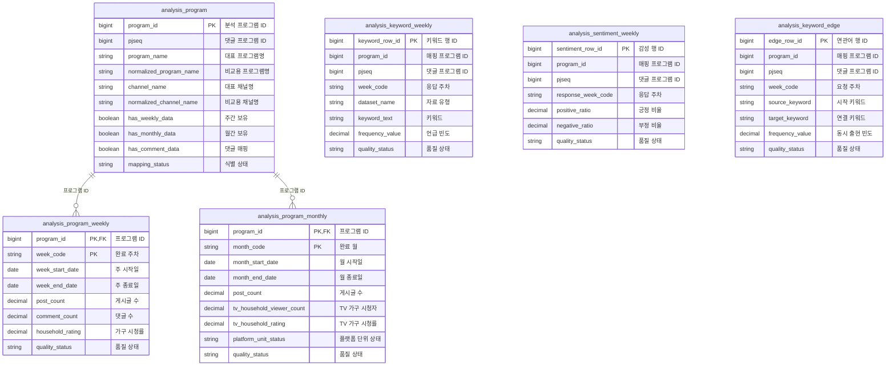

# 이슈 5 분석용 테이블 ERD

> raw 원본은 수정하지 않고, 이 문서의 분석 테이블은 `노트북/02_데이터_적재_품질_및_전처리.ipynb` SQL로 재생성한다.

## raw 원본에서의 유입

| 분석 테이블 | raw 원본 | 생성 방식 |
|---|---|---|
| `analysis_program` | `raw_internet_response`, `raw_total_response` | 프로그램명·채널의 기호·공백만 정리한 조합을 프로그램 1개로 만든다. 다른 채널은 합치지 않는다. |
| `analysis_program_weekly` | `raw_internet_response` | 프로그램·주차별로 내용 지문이 하나일 때만 원본 수치를 숫자형으로 변환한다. 서로 다른 내용이면 충돌 상태와 NULL 수치로 남긴다. |
| `analysis_program_monthly` | `raw_total_response` | 프로그램·월별로 같은 규칙을 적용한다. 주간 값으로 바꾸지 않으며 플랫폼 단위는 미확인 상태를 유지한다. |
| `analysis_keyword_weekly` | `raw_comment_keyword` | 키워드 배열 객체 하나를 한 행으로 보존한다. |
| `analysis_sentiment_weekly` | `raw_comment_sentiment` | 감성 배열 객체 하나를 한 행으로 보존하고 긍정·부정 비율 합계를 검사한다. |
| `analysis_keyword_edge` | `raw_comment_network` | 네트워크 배열 객체 하나를 한 행으로 보존한다. |

댓글 분석 테이블의 `program_id`는 현재 NULL이다. 댓글 원본의 `pjseq=11487`을 프로그램명·채널로 자동 연결할 수 없기 때문이다. 이는 댓글 0건이 아니라 **매핑 근거 미확보** 상태다.
