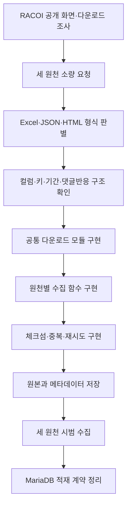
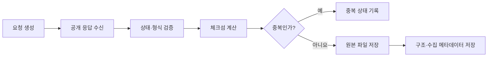

# 이슈 #3 RACOI 데이터 수집 모듈 개발계획

## 1. 단계 목표

이 단계에서는 실제 RACOI 공개 자료를 소량 내려받아 응답 형식을 확인하고, 최근 1년 자료를 안전하고 반복 가능하게 수집할 수 있는 Python 모듈을 구현한다.

최종 결과는 다음 세 가지다.

1. 인터넷반응·종합반응·댓글반응 자료를 내려받는 수집 코드
2. Excel·JSON·HTML 실제 응답 구조와 댓글반응 제공 범위 조사 결과
3. 후속 MariaDB 원본 테이블 적재를 위한 레코드 단위와 출처 추적 기준

이번 단계에서는 MariaDB 테이블 생성, 데이터 정제, 분석 지표, 후보 순위와 그래프를 만들지 않는다.

## 2. 전체 개발 흐름



## 3. 작업 브랜치와 대상 파일

작업 브랜치:

```text
feature/issue-3-racoi-collector
```

구현 대상:

```text
수집/
├── RACOI_자료_내려받기.py
└── 수집_실행.py
```

원본 저장 위치:

```text
데이터/원본/
├── 인터넷반응_주간/
├── 종합반응_월간/
└── 댓글반응_상세/
```

## 4. 실제 RACOI 요청 구조 조사

2026년 11월 28일 소량 시범 요청으로 확인한 실제 URL·매개변수·Excel·JSON 구조는 [`RACOI_응답_구조_조사_결과.md`](RACOI_응답_구조_조사_결과.md)에 기록한다.

코드 작성에 앞서 다음 공개 화면과 다운로드 기능을 조사한다.

1. 인터넷반응DB 다운로드 화면
2. 종합반응DB 다운로드 화면
3. `pjseq=11487` 댓글반응 상세 페이지
4. RACOI 이용안내와 공개 범위

각 화면에서 다음 내용을 확인한다.

| 확인 항목 | 확인 목적 |
|---|---|
| 요청 URL | 재현 가능한 수집 경로 확인 |
| GET·POST 방식 | 올바른 요청 생성 |
| 날짜·기간 매개변수 | 주간·월간 반복 수집 |
| 프로그램 식별자 | 댓글반응과 프로그램 연결 |
| 응답 콘텐츠 유형 | Excel·JSON·HTML 처리 방식 결정 |
| 페이지네이션 | 전체 레코드 수집 가능 여부 판단 |
| 쿠키·로그인 요구 | 공개 수집 범위 확인 |
| 오류 응답 형태 | 정상 파일과 오류 페이지 구분 |
| 공식 다운로드 링크 | 화면 재구성보다 원본 다운로드 우선 |

접근제어를 우회하거나 로그인 정보를 하드코딩하지 않는다. 공개 경로가 변경되었거나 접근이 제한되면 우회하지 않고 실패와 제한사항을 기록한다.

## 5. 소량 시범 요청

전체 1년 자료를 받기 전에 다음 범위로 실제 응답을 확인한다.

| 원천 | 첫 확인 범위 | 확인 목적 |
|---|---|---|
| 인터넷반응DB | 완료된 한 주 | 주간 파일 형식과 컬럼 확인 |
| 종합반응DB | 완료된 한 달 | 월간 파일 형식과 컬럼 확인 |
| 댓글반응 상세 | `pjseq=11487` 한 프로그램 | 키워드·감성·연관어 제공 범위 확인 |

실제 응답은 확장자만 믿지 않고 HTTP 헤더와 파일 시그니처를 함께 확인하여 다음 중 하나로 판별한다.

- XLSX 또는 XLS
- JSON
- CSV
- HTML
- 압축 파일
- 오류 안내 페이지

## 6. Excel 응답 구조 확인

Excel 응답에서는 다음 정보를 확인한다.

- 실제 파일 형식과 확장자의 일치 여부
- 시트 이름과 시트 개수
- 제목·설명 행과 실제 헤더 행 위치
- 원본 컬럼명
- 날짜·숫자·비율 표현
- 빈 행, 병합 셀과 각주
- 전체 원본 행 수
- 프로그램 식별자
- 주차 또는 월 식별자

구조 조사 결과는 다음 형태로 정리한다.

| source | sheet | header_row | row_count | 주요 식별자 | 비고 |
|---|---|---:|---:|---|---|
| 인터넷반응 | 실제 확인 후 기록 | 실제 확인 후 기록 | 실제 확인 후 기록 | 프로그램·주차 | 실제 확인 후 기록 |
| 종합반응 | 실제 확인 후 기록 | 실제 확인 후 기록 | 실제 확인 후 기록 | 프로그램·월 | 실제 확인 후 기록 |

Python은 Excel 구조와 값을 읽어 원본 표본을 확인할 수 있지만 이 단계에서 결측 처리, 형식 변환, 집계와 순위를 계산하지 않는다.

## 7. JSON 응답 구조 확인

JSON 응답에서는 다음을 확인한다.

- 최상위 값이 객체인지 배열인지
- 실제 레코드 배열이 있는 키
- 중첩 객체와 배열
- 키 이름과 값의 자료형
- `null`, 빈 배열과 누락 키
- 프로그램 식별자
- 기준일, 주차 또는 월
- 페이지 번호, 페이지 크기와 전체 건수
- 감성·키워드·연관어의 레코드 구조

구조는 예시로 가정하지 않고 실제 응답을 기준으로 기록한다. 반복되는 레코드 배열과 단일 메타데이터 객체를 구분하여 후속 MariaDB 적재 단위를 결정한다.

## 8. 댓글반응 분석 가능성 확인

`pjseq=11487`은 댓글반응 상세 페이지의 공개 제공 범위를 조사하기 위한 첫 번째 대상이다. 이 프로그램만 최종 분석한다는 의미가 아니다.

| 확인 항목 | 필요한 이유 |
|---|---|
| `pjseq` | 프로그램 연결 |
| 기준일 또는 분석 기간 | 최근 4주·8주 비교 가능 여부 |
| 키워드 | Q4 관심 주제 분석 |
| 키워드 언급량 | 프로그램별 관심 강도 비교 |
| 연관어와 연결 강도 | 관심 주제 관계 확인 |
| 긍정·중립·부정 건수 | Q6 감성 비율 계산 |
| 제공 감성 비율 | 제공값과 직접 계산값 검증 |
| 페이지네이션 | 전체 데이터 확보 가능 여부 |
| 전체 표본 수 | 감성 결과의 충분성 판단 |

확인 결과는 다음 원칙으로 판단한다.

| 실제 제공 범위 | 가능한 분석 | 제한사항 |
|---|---|---|
| 키워드와 감성 모두 제공 | Q4·Q6 구현 가능 | 기간·표본 단위 추가 확인 |
| 키워드만 제공 | Q4 구현 가능 | Q6 감성 위험 분석 제한 |
| 감성에 기간 정보 없음 | 후보 간 현재 분포 비교 | 최근 8주 변화 분석 불가 |
| 차트 이미지만 제공 | 화면에 공개된 범위 확인 | 숫자 추정 금지 |
| 공개 데이터 미제공 | 미제공으로 기록 | 비공개 경로 우회 금지 |

RACOI가 감성 집계를 제공하지 않는 경우 댓글 원문을 임의 수집하거나 Python·머신러닝 감성분석으로 대체하지 않는다.

## 9. 공통 다운로드 모듈

대상 파일은 `수집/RACOI_자료_내려받기.py`다.



주요 함수 구성안:

| 함수 | 역할 |
|---|---|
| `create_session()` | 재시도와 기본 헤더를 가진 HTTP 세션 생성 |
| `request_source()` | 공개 URL 요청 |
| `detect_response_format()` | Excel·JSON·CSV·HTML 형식 판별 |
| `validate_response()` | 오류 페이지와 비정상 파일 차단 |
| `calculate_checksum()` | SHA-256 체크섬 계산 |
| `build_file_name()` | 원천·기간·프로그램 기반 파일명 생성 |
| `save_original_response()` | 응답 바이트를 수정 없이 저장 |
| `inspect_excel_structure()` | 시트·헤더·컬럼 구조 확인 |
| `inspect_json_structure()` | 배열·키·중첩 구조 확인 |
| `save_metadata()` | 수집·구조 메타데이터 저장 |

함수명과 내부 분리는 실제 응답 구조를 확인한 뒤 단순하고 테스트 가능한 형태로 조정한다.

## 10. 원천별 수집 함수

공통 다운로드 기능 위에 다음 원천별 진입점을 둔다.

```text
download_weekly_internet_response()
download_monthly_total_response()
download_comment_analysis()
```

각 함수는 다음 정보만 원천별로 결정한다.

- 요청 URL
- 요청 매개변수
- 기간 표현 방식
- 프로그램 식별자
- 예상 응답 형식
- 저장 폴더

응답 검증, 체크섬, 중복 통제, 원본 저장과 메타데이터 기록은 공통 코드로 처리한다.

## 11. 전체 실행 모듈

대상 파일은 `수집/수집_실행.py`다.

실행 순서:

1. `.env` 설정 읽기
2. 최신 완료 기준일과 최근 1년 범위 확정
3. 완료 주차와 완료 월 작업 목록 생성
4. 인터넷반응·종합반응·댓글반응 수집 함수 호출
5. 성공·중복·실패 결과 수집
6. 실행 요약 반환

사용 환경변수:

```text
RACOI_BASE_URL
DATA_START_DATE
DATA_END_DATE
```

실제 쿠키, 로그인 정보와 개인 식별정보는 환경변수에도 추가하지 않는다.

## 12. 원본 파일명과 저장 규칙

파일명에는 다음 정보를 포함한다.

```text
원천_시작기간_종료기간_프로그램식별자_체크섬일부.확장자
```

예상 형태:

```text
인터넷반응_주간_2026-11-16_2026-11-22_a82f93c1.xlsx
종합반응_월간_2026-10_2026-10_d930ba21.xlsx
댓글반응_상세_pjseq-11487_2026-11-28_1fa009de.json
```

실제 기간 표현과 확장자는 응답을 확인한 뒤 확정한다. 원본 파일은 `.gitignore`에 따라 GitHub에 올리지 않는다.

## 13. 수집·구조 메타데이터

각 원본과 연결되는 메타데이터에는 다음 항목을 기록한다.

| 항목 | 의미 |
|---|---|
| `source_name` | 인터넷반응·종합반응·댓글반응 구분 |
| `source_url` | 실제 공개 요청 주소 |
| `collected_at` | 수집 시각 |
| `period_start`·`period_end` | 대상 기간 |
| `pjseq` | 프로그램 식별자 |
| `http_status` | HTTP 응답 상태 |
| `content_type` | 응답 콘텐츠 유형 |
| `response_format` | Excel·JSON·CSV·HTML 판별 결과 |
| `checksum` | SHA-256 체크섬 |
| `file_path` | 원본 파일 경로 |
| `row_count` | 확인 가능한 원본 레코드 수 |
| `collection_status` | 성공·중복·실패 상태 |
| `structure_summary` | 시트·컬럼 또는 JSON 키 구조 요약 |

메타데이터는 원본과 함께 보존하고 이슈 #5에서 `raw_ingestion_log`로 적재한다. 별도의 로그 폴더는 만들지 않는다.

## 14. 중복 통제

```text
동일 원천 + 동일 기간 + 동일 체크섬
→ 기존 원본 유지
→ 새 원본 저장 생략
→ duplicate 또는 skipped 상태 기록
```

같은 원천과 기간이라도 응답 내용이 달라 체크섬이 바뀌면 기존 원본을 덮어쓰지 않고 새 버전으로 보존한다.

## 15. 실패와 재시도

다음 오류는 제한된 횟수와 대기 시간을 두고 재시도한다.

- 연결 시간 초과
- 일시적인 네트워크 오류
- HTTP 429
- HTTP 5xx

다음 상황은 우회하지 않고 실패로 기록한다.

- 로그인 요구
- 접근 거부
- 필수 매개변수 변경
- 공개 자료 삭제
- 예상 형식과 다른 오류 페이지

HTTP 200이어도 오류 안내 HTML이나 비정상적으로 작은 파일일 수 있으므로 상태 코드만으로 성공 처리하지 않는다.

## 16. 원본 파일과 MariaDB 테이블의 역할

원본 파일과 MariaDB 원본 테이블은 중복 낭비가 아니라 서로 다른 역할을 가진다.

| 계층 | 역할 |
|---|---|
| 원본 Excel·JSON·HTML | RACOI가 실제 제공한 응답의 증거와 재처리 기준 |
| MariaDB 원본 테이블 | SQL 품질검사와 조회를 위한 행 단위 표현 |
| MariaDB 분석용 테이블 | 정제·집계된 Q1~Q6 분석 입력 |

권장 흐름:


다음 구조는 사용하지 않는다.

```text
원본 Excel·JSON → 변환 CSV → 정리 CSV → MariaDB 원본 → 분석용 테이블
```

불필요한 중간 사본은 기준 파일 혼란과 버전 불일치를 만들기 때문이다. Excel 바이너리 자체를 MariaDB BLOB으로 저장하지 않고, 원본 파일은 파일 시스템에 보존하며 원본 행만 raw 테이블에 적재한다.

## 17. MariaDB 적재 전달 기준

이슈 #3에서는 DB를 생성하지 않지만 후속 이슈가 바로 적재할 수 있도록 다음 계약을 남긴다.

| 원본 | MariaDB 적재 단위 |
|---|---|
| 인터넷반응 Excel | 원본 시트 데이터 행 1개 |
| 종합반응 Excel | 원본 시트 데이터 행 1개 |
| 댓글반응 JSON | 안정적으로 반복되는 JSON 레코드 1개 |
| 수집 메타데이터 | 다운로드 시도 1회 |

각 원본 행은 다음 출처 정보와 연결한다.

- `ingestion_run_id`
- 원본 파일 경로
- 체크섬
- 시트명 또는 레코드 유형
- 원천 행 번호
- 수집 시각

JSON 전체 원문은 파일로 보존한다. DB에도 전체 payload가 필요한 경우 MariaDB 실제 버전을 확인한 뒤 JSON 또는 LONGTEXT 컬럼을 사용한다.

## 18. 구현 순서

1. 최신 `main` 기준 이슈 #3 브랜치 준비
2. RACOI 공개 이용안내와 세 원천의 실제 요청 조사
3. 한 주·한 달·한 프로그램 소량 시범 요청
4. Excel·JSON·HTML 구조와 댓글반응 제공 범위 기록
5. 공통 요청·검증·형식 판별 코드 구현
6. 원본 파일명·저장·메타데이터 코드 구현
7. 체크섬·중복·재시도·실패 처리 구현
8. 인터넷반응·종합반응·댓글반응 원천별 함수 구현
9. `.env` 기간을 사용하는 전체 실행 모듈 구현
10. 세 원천 시범 수집과 재실행 중복 확인
11. 구조 조사 결과와 MariaDB 전달 계약 문서화
12. 실제 수집 파일과 비밀정보를 제외하고 코드·문서만 PR에 포함

## 19. 완료 확인 시나리오

이슈 #3은 다음 조건을 모두 확인하면 완료한다.

- [ ] 인터넷반응 한 주 수집 성공
- [ ] 종합반응 한 달 수집 성공
- [ ] `pjseq=11487` 댓글반응 수집 또는 미제공 범위 확인
- [ ] 각 원천의 실제 Excel·JSON·HTML 형식 판별
- [ ] Excel 시트·헤더·컬럼 또는 JSON 키·배열 구조 기록
- [ ] 댓글반응의 키워드·감성·연관어·기간 제공 여부 기록
- [ ] 원본 파일과 수집·구조 메타데이터 저장
- [ ] 동일 작업 재실행 시 중복 파일 미생성
- [ ] 실패 응답이 성공 파일로 저장되지 않음
- [ ] MariaDB 적재에 필요한 레코드 단위와 식별자 확인
- [ ] 원본 자료, 쿠키, 비밀번호와 개인 식별정보가 Git에 포함되지 않음

## 20. 제외 범위

- MariaDB 데이터베이스와 테이블 생성
- Excel·JSON 원본의 정제·수정
- 결측값 대체와 중복 행 제거
- 프로그램명 통합
- 분석 지표와 후보 순위
- Q1~Q6 그래프
- 댓글 원문 수집과 자체 감성분석 모델

후속 단계는 다음 순서로 이어진다.

1. 이슈 #4에서 수집 범위, 응답 구조와 원본 표본을 노트북 표로 확인한다.
2. 이슈 #5에서 실제 구조를 기준으로 MariaDB 원본·분석용 테이블을 생성한다.
